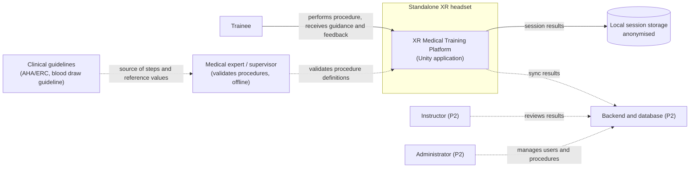
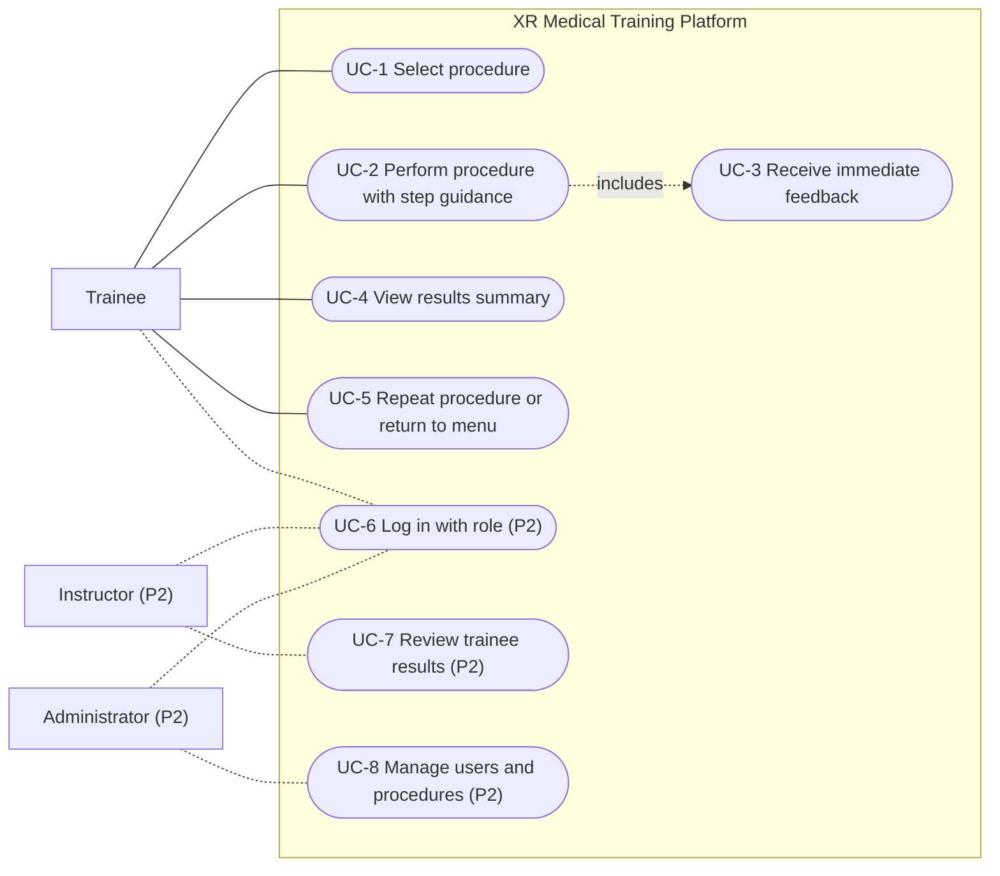
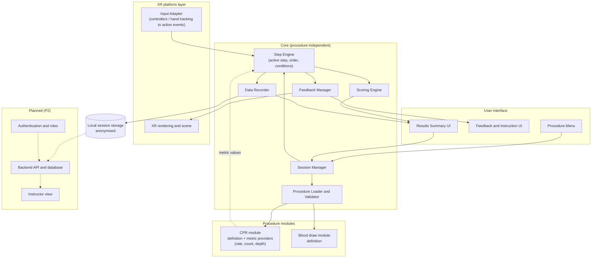
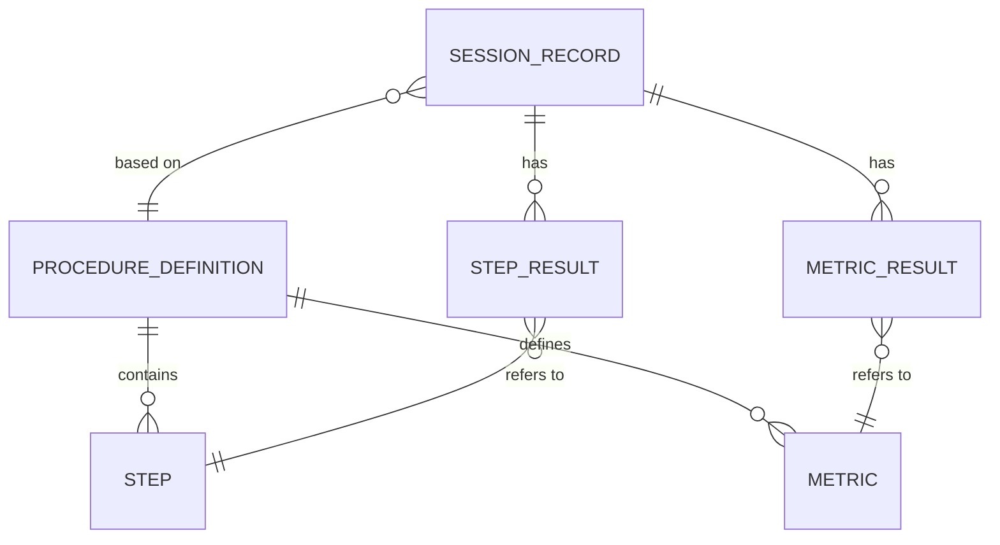
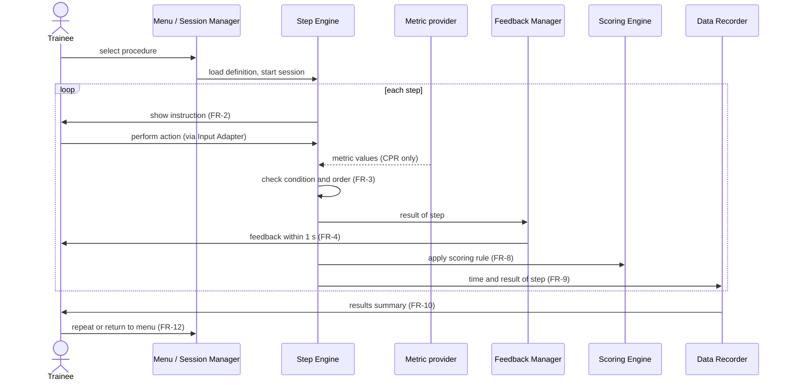

# 7. Architecture and diagrams

## 7.1 Overview

The prototype (P1) is a single Unity application for a standalone XR headset. It contains a core that is independent of any procedure and a procedure module that describes each procedure (steps, conditions, metrics, scoring rules). CPR and blood draw are two procedure modules loaded by the same core, so the second procedure can be added without changes to the core (FR-11, NFR-8). Roles, persistent storage and the instructor view (P2) are shown as planned components and are not part of the P1 prototype.

Main design decisions:
- **Procedure as data.** Steps, conditions, scoring rules and guideline references are stored in a procedure definition file, not in core code (FR-11, NFR-5, NFR-8).
- **Input is isolated.** The Input Adapter converts controller or hand-tracking input into device-independent action events, so the device decision (Section 5) does not change the core (FR-6, NFR-2).
- **Metrics are pluggable.** The core defines a metric interface. Continuous CPR metrics (rate, count, depth) are implemented as metric providers that belong to the CPR module, not to the core (FR-5, FR-6, FR-9).
- **Local anonymised storage in P1.** Session results contain no personal identifiers (NFR-6). Persistent storage and accounts are P2 (FR-14).

## 7.2 System context diagram



Solid lines are P1, dotted lines are offline processes or P2.

## 7.3 Use case diagram



| Use case | Requirements | Stage |
|---|---|---|
| UC-1 Select procedure | FR-1 | P1 |
| UC-2 Perform procedure with step guidance | FR-2, FR-3, FR-5, FR-6, FR-7, FR-8, FR-9 | P1 |
| UC-3 Receive immediate feedback | FR-4 | P1 |
| UC-4 View results summary | FR-10 | P1 |
| UC-5 Repeat procedure or return to menu | FR-12 | P1 |
| UC-6 Log in with role | FR-13 | P2 |
| UC-7 Review trainee results | FR-14, FR-15 | P2 |
| UC-8 Manage users and procedures | FR-13 | P2 |

## 7.4 Component diagram (draft)



| Component | Responsibility | Requirements |
|---|---|---|
| Input Adapter | Converts device input into action events; the only place that depends on the input method | FR-5, FR-6, NFR-2 |
| Procedure Menu | Lists available procedures, starts the selected one | FR-1, FR-12 |
| Procedure Loader and Validator | Reads a procedure definition, checks that every step has a condition, a scoring rule and a guideline reference | FR-11, NFR-5, NFR-8 |
| Session Manager | Controls session start, end, restart and return to menu | FR-1, FR-12 |
| Step Engine | Activates steps in order, evaluates conditions, accepts or rejects actions | FR-2, FR-3, FR-7 |
| Metric providers (in procedure modules) | Compute procedure-specific metrics such as CPR rate, count and depth | FR-5, FR-6 |
| Feedback Manager | Shows visual or audio feedback within 1 s after an action | FR-4 |
| Scoring Engine | Applies the scoring rule of each step and computes the session score | FR-8 |
| Data Recorder | Records time and result per step and the CPR metrics; writes anonymised local data | FR-9, NFR-6 |
| Results Summary UI | Shows total time, completed, missed and incorrect steps, score, CPR rate and count | FR-10 |
| Authentication and roles, Backend, Instructor view | Planned for P2 | FR-13, FR-14, FR-15 |

## 7.5 Data and procedure definition format

A procedure is described by a definition file (JSON or a Unity ScriptableObject; the final choice is made during implementation). The same format is used for CPR and blood draw (NFR-8).

```json
{
  "procedureId": "cpr-basic",
  "name": "Basic CPR",
  "guidelineRef": "<AHA/ERC reference>",
  "steps": [
    {
      "stepId": "S1",
      "order": 1,
      "instruction": "Check responsiveness",
      "condition": { "type": "action", "action": "check_response" },
      "guidelineRef": "<section of guideline>",
      "scoring": { "type": "pass_fail", "points": 1 },
      "feedback": { "correct": "Correct", "incorrect": "Check responsiveness first" }
    }
  ],
  "metrics": [
    { "metricId": "rate", "provider": "CompressionRate", "referenceRange": [100, 120], "unit": "per_min" },
    { "metricId": "count", "provider": "CompressionCount" }
  ]
}
```

Rules of the format:
- Every step has an order, an instruction, a condition, a scoring rule and a guideline reference. Steps without a validated reference are marked `"validated": false` (NFR-5).
- A condition has a type (action, ordered action, metric threshold) and its parameters.
- A scoring rule is at least pass/fail (FR-8).
- Metrics are optional. Their providers are registered by the procedure module, so the core is not changed (FR-5, FR-11).

Session data produced by the Data Recorder:



| Entity | Main fields |
|---|---|
| SESSION_RECORD | anonymous sessionId, procedureId, start time, end time, total time, score |
| STEP_RESULT | stepId, time spent, result (passed, missed, incorrect) |
| METRIC_RESULT | metricId, measured value, within reference range (yes/no) |

No name, account or device identifier is stored in P1 (NFR-6).

## 7.6 Main scenario (sequence)



Error case: if an action is wrong or out of order, the Step Engine rejects it, the Feedback Manager shows the error, and the step stays active until the trainee corrects it. The result is recorded as incorrect.

## 7.7 Consistency check: requirements, components, data, scenarios

| Requirement | Component | Data | Scenario |
|---|---|---|---|
| FR-1 | Procedure Menu, Session Manager | list of procedure definitions | UC-1 |
| FR-2 | Step Engine, Feedback and instruction UI | step.instruction | UC-2 |
| FR-3 | Step Engine | step.condition, order | UC-2, error case |
| FR-4 | Feedback Manager | step.feedback | UC-3 |
| FR-5, FR-6 | CPR metric providers, Input Adapter | metric, METRIC_RESULT | UC-2 (CPR) |
| FR-7 | Step Engine, blood draw module | blood draw definition | UC-2 (blood draw) |
| FR-8 | Scoring Engine | step.scoring | UC-2, UC-4 |
| FR-9 | Data Recorder | STEP_RESULT, METRIC_RESULT | UC-2 |
| FR-10 | Results Summary UI | SESSION_RECORD | UC-4 |
| FR-11, NFR-8 | Procedure Loader and Validator, procedure modules | procedure definition format (7.5) | adding blood draw |
| FR-12 | Session Manager, Menu | none | UC-5 |
| FR-13, FR-14, FR-15 | Auth, Backend, Instructor view (P2) | persistent SESSION_RECORD | UC-6, UC-7 |
| NFR-1, NFR-2 | XR platform layer, Input Adapter | none | all scenarios on the device |
| NFR-3, NFR-4, NFR-9 | UI, XR rendering | none | UC-2 |
| NFR-5 | Procedure Loader and Validator | guidelineRef, validated flag | definition review |
| NFR-6 | Data Recorder, local storage | anonymous SESSION_RECORD | UC-4 |
| NFR-7 | whole application | none | 10 full sessions |

Checks: every Must requirement maps to at least one component, one data item and one scenario; every P1 component serves at least one requirement; P2 components are separated from P1 in all diagrams.

## 7.8 Open points

- The headset and input method will be fixed in Section 5; the Input Adapter hides the difference, but FR-6 (depth) depends on it.
- The format of the definition file (JSON or ScriptableObject) will be fixed at implementation; the fields in 7.5 stay the same.
- The guideline for blood draw must be selected and listed in Section 12.
