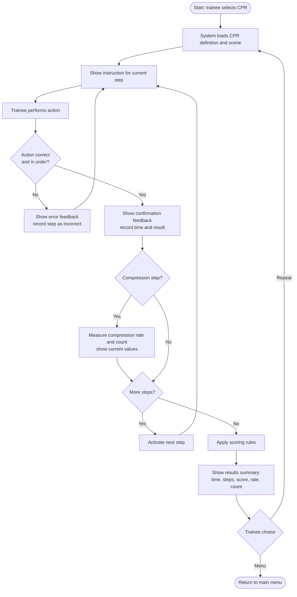

# 8. UX / Prototype

Project: Development of an AR/VR Application for Professional Training of Medical Specialists

This section shows how users interact with the application in the key scenarios of the prototype (P1). The scenarios follow the use cases of Section 7 (UC-1 to UC-5). Each screen is marked as implemented in the Unity prototype or as a mockup.

## 8.1 Interaction model

- Device: standalone XR headset (Meta Quest), two controllers (Section 5).
- Menus and panels: world-space UI operated with a controller ray and the trigger button.
- Procedure actions: performed in the virtual scene with the controllers (grab tools, press on the manikin chest, and so on); the Input Adapter converts them into device-independent action events (Section 7).
- Session length: up to 15 minutes (NFR-9).
- Design principles, taken from the interviews (Section 2) and the literature (Section 3):
  - guidance for the current step is always visible (FR-2);
  - feedback appears immediately after an action (FR-4, E4);
  - the trainee can repeat a procedure without restarting the application (FR-12, E2);
  - the summary shows mistakes, time and score (FR-10, E7).

## 8.2 Key user scenarios

### Scenario 1: Select a procedure (UC-1)

1. The trainee puts on the headset and sees the main menu with the list of procedures (CPR, blood draw).
2. The trainee points the controller ray at a procedure and presses the trigger.
3. The training scene for the selected procedure loads.

<screenshot or mockup: S1 Main menu>

### Scenario 2: Perform a procedure with step guidance (UC-2, UC-3)

1. The instruction panel shows the current step (for example "Check responsiveness") and the step number.
2. The trainee performs the action in the scene.
3. The system checks the action against the step condition.
4. If the action is correct, the feedback panel shows a confirmation and the next step becomes active.
5. If the action is wrong or out of order, the feedback panel shows the error, and the step stays active until the trainee corrects it.
6. In the CPR procedure, the current compression rate and count are shown during the compression step.

<screenshot or mockup: S2 Training scene with instruction panel>
<screenshot or mockup: S3 Correct and incorrect feedback>

### Scenario 3: View the results summary (UC-4)

After the last step the summary screen shows: total time, number of completed, missed and incorrect steps, score, and for CPR the compression rate and count (FR-10).

<screenshot or mockup: S4 Results summary>

### Scenario 4: Repeat or return to the menu (UC-5)

From the summary screen the trainee chooses "Repeat" to restart the same procedure or "Menu" to return to the procedure list (FR-12).

<screenshot or mockup: S5 Repeat / menu buttons on the summary screen>

### Planned (P2): Instructor view (UC-7)

A mockup of the instructor screen listing trainee sessions with score, time and errors per step. This screen is a mockup only and is not implemented in P1.

<mockup: S6 Instructor view (P2)>

## 8.3 CPR procedure flow (activity diagram)

The diagram shows the flow of the CPR procedure from the trainee's point of view, including the error case: a wrong or out-of-order action is rejected, feedback is shown, and the same step stays active until the trainee corrects it (FR-3, FR-4). The step list follows the CPR procedure definition (Section 7.5) and the guideline reference [35]. The sequence of component calls is shown in Section 7.6.

Steps of the CPR procedure (to be aligned with the definition file):

| Step | Instruction | Condition |
|------|-------------|-----------|
| S1 | Check responsiveness | Action: check_response |
| S2 | <next step, for example: call for help / activate emergency response> | <action> |
| S3 | <next step, for example: check breathing> | <action> |
| S4 | Perform chest compressions | Metric: rate and count within reference range |
| S5 | <optional: use the AED, if included in the prototype> | <action> |

## 8.4 Screen inventory

| Screen | Use case | Requirements | Status |
|--------|----------|--------------|--------|
| S1 Main menu | UC-1 | FR-1 | <implemented / mockup> |
| S2 Training scene with instruction panel | UC-2 | FR-2, FR-3 | <implemented / mockup> |
| S3 Feedback panel | UC-3 | FR-4 | <implemented / mockup> |
| S4 Results summary | UC-4 | FR-9, FR-10 | <implemented / mockup> |
| S5 Repeat / menu | UC-5 | FR-12 | <implemented / mockup> |
| S6 Instructor view | UC-7 | FR-14, FR-15 | Mockup, P2 |

## 8.5 Interaction table

| User action | Input | System response | Requirement |
|-------------|-------|-----------------|-------------|
| Select a procedure | Controller ray and trigger | Loads the procedure definition and scene | FR-1 |
| Perform a procedure step | Controller action in the scene (grab, press, move) | Checks the condition, shows feedback, activates the next step | FR-2, FR-3, FR-4 |
| Perform chest compressions (CPR) | Controller movement over the manikin chest | Counts compressions and shows the rate; depth is estimated if the input device allows it | FR-5, FR-6 |
| Finish the procedure | Last step completed | Shows the results summary | FR-10 |
| Repeat or return | Controller ray and trigger | Restarts the procedure or opens the menu | FR-12 |

## 8.6 Limitations of the prototype

- Screens marked as mockup are not yet implemented in Unity.
- Interaction was tested in the XR Device Simulator; testing on a physical headset depends on getting access to one (Section 9).
- Compression depth depends on the input device and is not yet verified.
- Hand tracking is not used in P1; interaction is controller-based.
